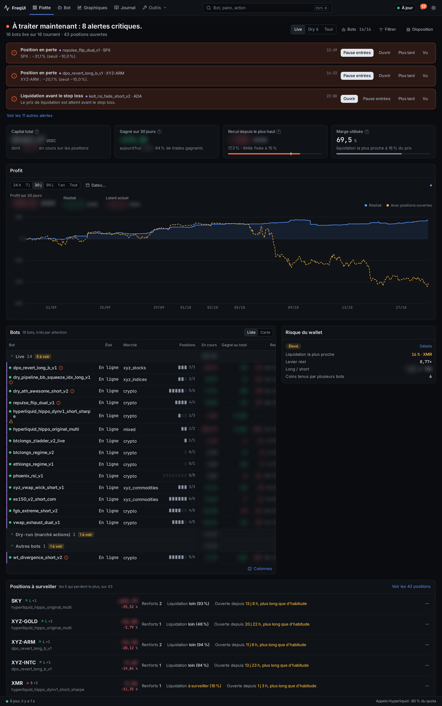
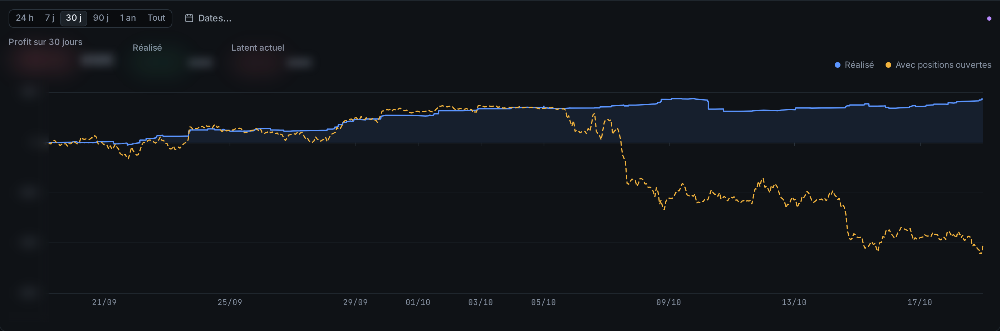
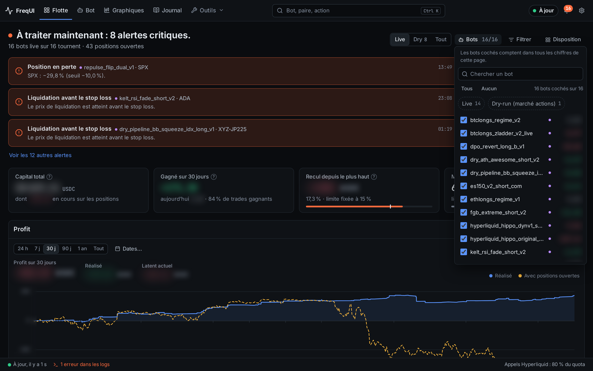
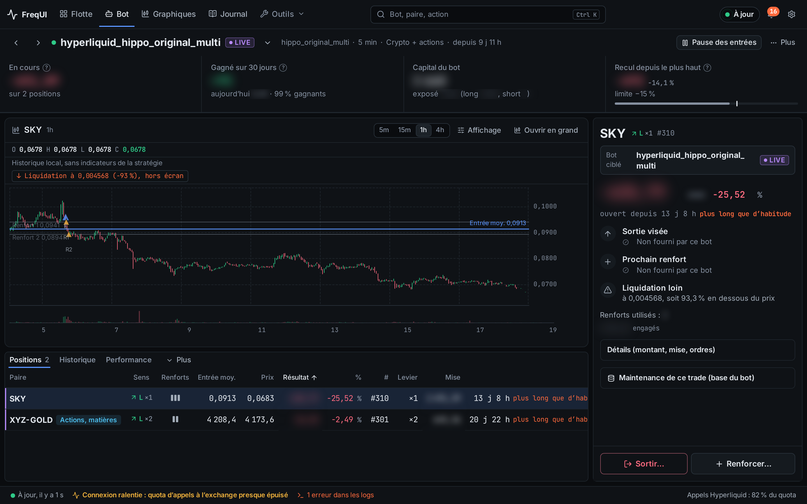
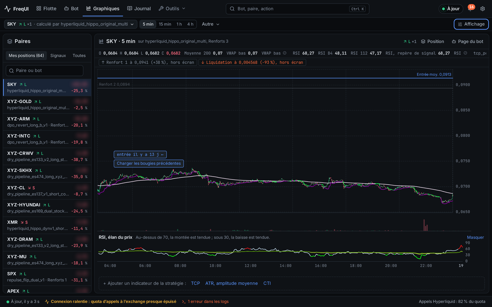
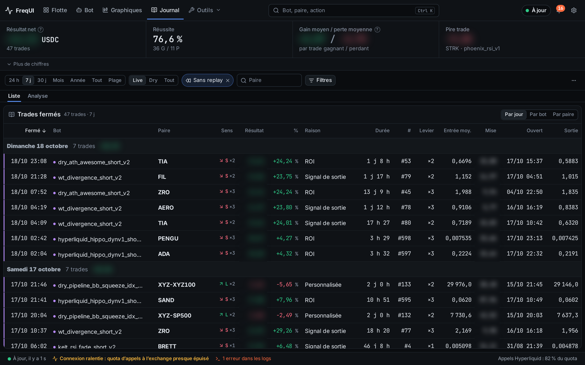
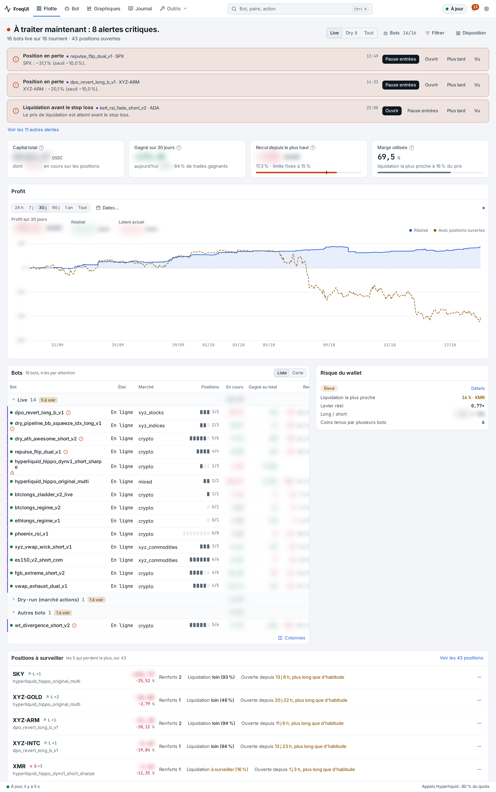
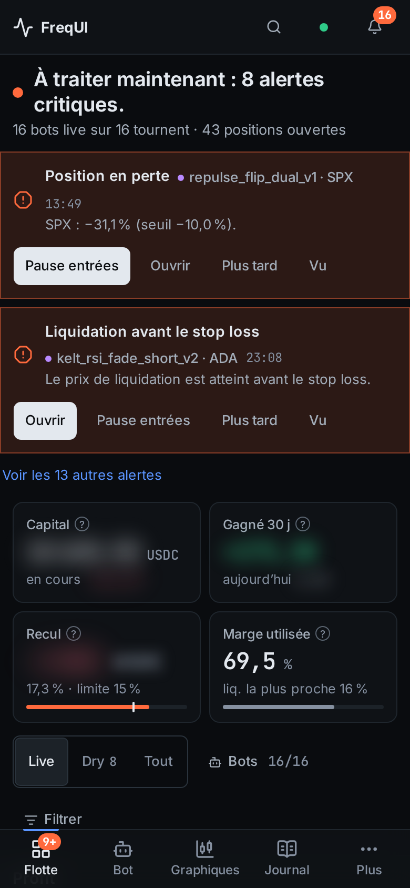

<p align="center">
  
</p>

<p align="center">
  <a href="LICENSE"></a>
  <a href="https://github.com/titouannwtt/frequi-ultimate/stargazers"></a>
  
  
  <a href="https://buymeacoffee.com/freqtrade_france"></a>
</p>

<p align="center">
  <a href="#install"><b>Install</b></a> ·
  <a href="#the-gateway-optional"><b>Gateway</b></a> ·
  <a href="#how-it-works"><b>How it works</b></a> ·
  <a href="#highlights"><b>Highlights</b></a> ·
  <a href="#screenshots"><b>Screenshots</b></a> ·
  <a href="docs/UPGRADE.en.md"><b>Upgrade guide</b></a>
</p>

## What is FreqUI Ultimate?

A fork of [FreqUI](https://github.com/freqtrade/frequi), the Freqtrade web dashboard, rebuilt to run a whole fleet of Freqtrade trading bots from one screen, on a desktop or a phone. It is the companion of [freqtrade-ultimate](https://github.com/titouannwtt/freqtrade-ultimate), and it keeps working against any standard Freqtrade instance.

Version 2.0 is a full redesign: four first-class pages (Fleet, Bot, Charts, Journal), one data layer shared by every page, and an optional Rust service, the **gateway**, that reads your bots once for all your tabs and devices. Maintained by [Freqtrade France](https://buymeacoffee.com/freqtrade_france).

Coming from an earlier version? Read the [upgrade guide](docs/UPGRADE.en.md) ([français](docs/UPGRADE.fr.md)). Nothing to re-register: your bot list stays in your browser.

## Install

### Option A: through freqtrade-ultimate (recommended)

```bash
freqtrade install-ui --ui-version v2.0.0
```

`--ui-version` takes the name of a [release](https://github.com/titouannwtt/frequi-ultimate/releases) (a tag such as `v2.0.0`), not a URL. Without it, the latest release that is not a prerelease is installed.

### Option B: any Freqtrade, by hand

Stock `freqtrade install-ui` downloads the upstream FreqUI. Download `frequi-ultimate-ui-<tag>.zip` from the releases page and unzip it into `freqtrade/rpc/api_server/ui/installed/`.

### Option C: local development

```bash
git clone https://github.com/titouannwtt/frequi-ultimate.git
cd frequi-ultimate
pnpm install
pnpm dev
```

Then point it at any Freqtrade or [freqtrade-ultimate](https://github.com/titouannwtt/freqtrade-ultimate) instance via the standard FreqUI login flow.

## The gateway (optional)

`frequi-gateway` is a single static binary (Linux x86_64 and aarch64, no dependency) that runs next to your bots. It discovers them, reads their trades once, computes the fleet figures and alerts, and serves them over HTTP and WebSocket to every browser. Without it, the UI polls each bot itself (direct mode) and works as before; with it, ten tabs cost the same as one, and your preferences follow you from your computer to your phone.

```bash
sha256sum -c --ignore-missing SHA256SUMS
install -D -m 0755 frequi-gateway-x86_64-unknown-linux-musl ~/.local/bin/frequi-gateway
frequi-gateway print-default-config > ~/.config/frequi-gateway/config.toml   # set server.cors_origins
frequi-gateway check-config
frequi-gateway run
```

Authentication is mandatory, the port is `9399`, and the UI finds the gateway by itself and falls back to direct mode if it goes away. A systemd user unit, a screen launcher, a Docker image and an example configuration are in [`gateway/packaging`](gateway/packaging); the details, the security notes and the rollback are in the [upgrade guide](docs/UPGRADE.en.md). The design is in [`docs/redesign`](docs/redesign).

## How it works

<p align="center"></p>

- **The UI is still served by your bot**, from the same origin as before, so your saved bots and tokens keep working. Nothing is deployed in front of it.
- **Two data sources, one interface.** *Gateway mode* reads a pre-computed, de-duplicated state from the gateway. *Direct mode* (no gateway, or gateway down) polls the bots from the browser with ports of the same calculations, checked against shared test vectors (`gateway/fixtures/vectors`) run by both the Rust and the TypeScript side.
- **Freshness is always visible.** Every figure says how old it is; a stale or missing figure is shown as such, never as zero.
- **Fork-only panels.** Some fleet widgets call extra endpoints (`/fleet/*`, `/fleetview/*`, `/stratdev/*`, `/volume_history`, `/signal_summary`) served by freqtrade-ultimate; against a stock bot they stay empty.

**Stack:** Vue 3.5 · Pinia · PrimeVue (unstyled) · ECharts · TailwindCSS 4 · vue-i18n · Vite 8 · pnpm. Gateway: Rust, tokio, axum, SQLite (read-only).

## Highlights

- **Fleet** (`/dashboard`): live equity with unrealised P&L, realised profit by period, drawdown, exposure, every position, alerts and the health of the data sources.
- **Bot, Charts, Journal:** one bot in depth, candles with trades, and the full trade log with filters and export.
- **Safe actions.** Long and short are green and red with an arrow and an L/S letter; exiting a live position needs a one-second press-and-hold; a double click sends one request.
- **Time zone:** days, weeks and months are cut in Europe/Paris by default (UTC is one setting away).
- **Tools menu:** StrategyDev, Backtest, Download data and Pairlist stay available for open-source users, out of the way.
- **French and English.**

## Screenshots

Taken from a live fleet of 16 bots on FreqUI Ultimate 2.1. Amounts are blurred; percentages, prices and counts are real.

### Fleet

Alerts that need you now, capital, 30-day profit, drawdown against its limit, margin used, then the profit curve and every bot sorted by what needs attention.

<p align="center"></p>

### Global profit, realised and with open positions

One curve for the whole fleet over 24 h, 7 d, 30 d, 90 d, 1 year, all time or custom dates. The solid line is realised profit; the dashed line adds the latent P&L of open positions.

<p align="center"></p>

### Choose the bots that count

Tick the bots that feed every figure of the page, by group (live, dry-run, others) or one by one.

<p align="center"></p>

### Bot and trade chart

Click any trade: the pair chart opens on its entry, average entry and DCA orders, with the liquidation price flagged when it is off screen. Switch timeframe, or load older candles when the trade opened before the first one shown.

<p align="center"></p>

### Charts

Every position of the fleet in one list, with the strategy indicators the bot computes and a button to load the candles before the entry.

<p align="center"></p>

### Journal

Closed trades grouped by day, bot or pair, with net result, win rate, average win and loss, and filters by period, mode and pair.

<p align="center"></p>

### Light theme and phone

<p align="center">
  
  
</p>

## Learn algorithmic trading

**[Freqtrade France](https://buymeacoffee.com/freqtrade_france)** is the French-speaking algo trading community behind both freqtrade-ultimate and frequi-ultimate. Free tutorials, paid strategies, and live walkthroughs of how to use this dashboard with multi-bot setups.

- YouTube: [@freqtrade_france](https://www.youtube.com/@freqtrade_france)
- Twitter: [@MoutonCrypto](https://x.com/MoutonCrypto)
- Member tutorials: see [Freqtrade France](https://buymeacoffee.com/freqtrade_france) for the current offer and pricing. The public forks remain free to use.

If you don't want to subscribe but want to support the fork, the simplest free way is to use the [Hyperliquid referral link](https://app.hyperliquid.xyz/join/MOUTON) when creating your account.

## Contributing

See [CONTRIBUTING.md](CONTRIBUTING.md). Issues and PRs are welcome.

## License

GPL-3.0, same as upstream [FreqUI](https://github.com/freqtrade/frequi), which this project is a fork of. See [LICENSE](LICENSE).

---

<p align="center">
  Built and maintained by <b>Mouton 🐑</b> · <a href="https://buymeacoffee.com/freqtrade_france"><b>Freqtrade France</b></a>
</p>
