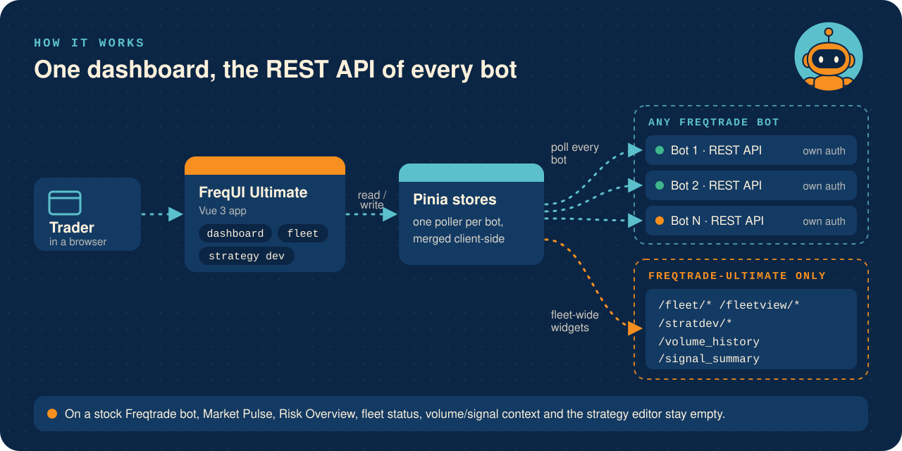

<p align="center">
  
</p>

<p align="center">
  <a href="LICENSE"></a>
  <a href="https://github.com/titouannwtt/frequi-ultimate/stargazers"></a>
  
  
  <a href="https://buymeacoffee.com/freqtrade_france"></a>
</p>

<p align="center">
  <a href="#install"><b>Install</b></a> ·
  <a href="#how-it-works"><b>How it works</b></a> ·
  <a href="#highlights"><b>Highlights</b></a> ·
  <a href="#screenshots"><b>Screenshots</b></a>
</p>

## What is FreqUI Ultimate?

A fork of [FreqUI](https://github.com/freqtrade/frequi), the Freqtrade web dashboard, redesigned to run a whole fleet of Freqtrade trading bots from one screen. It is the companion of [freqtrade-ultimate](https://github.com/titouannwtt/freqtrade-ultimate), but it is compatible with any standard Freqtrade instance.

It is rebuilt around two needs upstream doesn't address:

1. **Monitoring multiple Freqtrade bots simultaneously:** compare them side-by-side, alert on cross-bot anomalies, manage them as a fleet.
2. **Understanding the market context around your bots:** volume context, regime indicators, stress tests, alert detection.

148 files modified, +38 413 lines added, 50+ enhanced components, 6 languages out of the box. Maintained by [Freqtrade France](https://buymeacoffee.com/freqtrade_france).

## Install

### Option A: through freqtrade-ultimate (recommended)

```bash
freqtrade install-ui --ui-version github://titouannwtt/frequi-ultimate
```

### Option B: local development

```bash
git clone https://github.com/titouannwtt/frequi-ultimate.git
cd frequi-ultimate
pnpm install
pnpm dev
```

Then point it at any Freqtrade or [freqtrade-ultimate](https://github.com/titouannwtt/freqtrade-ultimate) instance via the standard FreqUI login flow.

## How it works

<p align="center"></p>

- **Fan-out polling.** Each bot is a separate Freqtrade REST API instance with its own auth. Pinia stores poll every bot independently and merge the results client-side into the fleet dashboard.
- **Fork-only widgets.** Fleet-wide panels call extra endpoints (`/fleet/*`, `/fleetview/*`, `/stratdev/*`, `/volume_history`, `/signal_summary`) served by freqtrade-ultimate.
- **Interactive diagram.** [`docs/diagrams/frequi-architecture.html`](docs/diagrams/frequi-architecture.html) shows how the fleet dashboard polls every bot's REST API and where the fork-only widgets plug in.

> [!NOTE]
> The advanced widgets (Market Pulse, Risk Overview, fleet status, volume/signal context, the in-browser strategy editor) are powered by REST endpoints that only exist in **[freqtrade-ultimate](https://github.com/titouannwtt/freqtrade-ultimate)**. Point this UI at a stock freqtrade bot and those panels stay empty: pair it with the fork for the full experience.

**Stack:** Vue 3.5 · Pinia · PrimeVue · ECharts · TailwindCSS 4 · vue-i18n · Monaco Editor · Vite 8 · pnpm.

## Highlights

<p align="center"></p>

### Dashboard redesign

- **DashboardViewCustom:** glassmorphism redesign with persistent layouts (Pinia store).
- **Enhanced widgets:** MarketPulse, ActivityTimeline, RiskOverview, StressTestCard, LogViewerEnhanced.
- **Enhanced charts:** ProfitBenchmarkChart, ProfitDistributionEnhanced, CumulativeProfitEnhanced, OpenTradesEnhanced, ClosedTradesEnhanced.
- **BotProfitComparisonChart:** per-bot realized P&L as a bar chart to compare bots head-to-head over a chosen window. Period selector (24h, today, 48h, 7d, 14d, 1/2/3/6 months, 1 year, All), live/all/dry filter, value in the summary currency or in % of allocated capital, sortable, with the fleet total. Honors the bots selected in *Bot comparison* intersected with its own live/dry filter. Profit is summed from each bot's cached closed trades (no extra API calls) and currencies are normalized via the dashboard's exchange rates.

### Multi-bot fleet management

- **BotComparisonList:** custom columns, tags, filters, sorting, groups, **13 alert types**, drag-drop reordering, CSV export, keyboard shortcuts (+4 530 lines over upstream).
- **Cross-bot popovers:** glassmorphism context cards: PeriodProfitCard, OpenProfitCard, ClosedProfitCard, BotInfoCard, ExchangeInfoCard.
- **Browser notifications:** trade events, alerts, fleet status changes.

### Strategy development UI

- **StrategyDev:** embedded Monaco editor for live strategy editing, job launcher (backtest / hyperopt from the UI), 15+ analysis cards. Hooks into the strategy-dev backend shipped in [freqtrade-ultimate](https://github.com/titouannwtt/freqtrade-ultimate).

### Internationalization

- **6 languages out of the box:** English, French, German, Spanish, Italian, Portuguese (1 200+ translation keys each).

### Settings and UX

- **SettingsViewCustom:** section cards, glassmorphism, notification settings, configuration export.
- **NavBar:** tab icons, PDF export, full i18n, glassmorphism.

## Screenshots

### Multi-bot dashboard

One glassmorphism screen for the whole fleet: live log console, cumulative profit vs BTC benchmark, per-bot comparison, and every open position with duration-health bars.


### Fleet comparison and alerts

Compare bots head-to-head with custom columns, tags, filters, groups, drag-drop ordering, and 13 cross-bot alert types.

<p align="center">
  
  
</p>

### Market context and portfolio risk

Widgets stock FreqUI doesn't have: Market Pulse (BTC dominance, Fear & Greed, fleet vs BTC/ETH) and a portfolio-wide Risk Overview (net/gross exposure, leverage, worst drawdown, correlation warnings).

<p align="center">
  
  
</p>

### Analytics widgets

Per-bot profit benchmarks, profit distribution, activity timeline, and a Monte-Carlo stress test.

<p align="center">
  
</p>
<p align="center">
  
  
</p>

### Rich context popovers

Hover any metric for a glassmorphism context card: open/closed profit, win/loss, DCA escalations, exit reasons, price levels, and more.

<p align="center">
  
  
</p>

## Learn algorithmic trading

**[Freqtrade France](https://buymeacoffee.com/freqtrade_france)** is the French-speaking algo trading community behind both freqtrade-ultimate and frequi-ultimate. Free tutorials, paid strategies, and live walkthroughs of how to use this dashboard with multi-bot setups.

- YouTube: [@freqtrade_france](https://www.youtube.com/@freqtrade_france)
- Twitter: [@MoutonCrypto](https://x.com/MoutonCrypto)
- Member tutorials: see [Freqtrade France](https://buymeacoffee.com/freqtrade_france) for the current offer and pricing. The public forks remain free to use.

If you don't want to subscribe but want to support the fork, the simplest free way is to use the [Hyperliquid referral link](https://app.hyperliquid.xyz/join/MOUTON) when creating your account.

## Contributing

See [CONTRIBUTING.md](CONTRIBUTING.md). Issues and PRs are welcome.

## License

GPL-3.0, same as upstream [FreqUI](https://github.com/freqtrade/frequi), which this project is a fork of. See [LICENSE](LICENSE).

---

<p align="center">
  Built and maintained by <b>Mouton 🐑</b> · <a href="https://buymeacoffee.com/freqtrade_france"><b>Freqtrade France</b></a>
</p>
